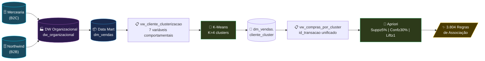
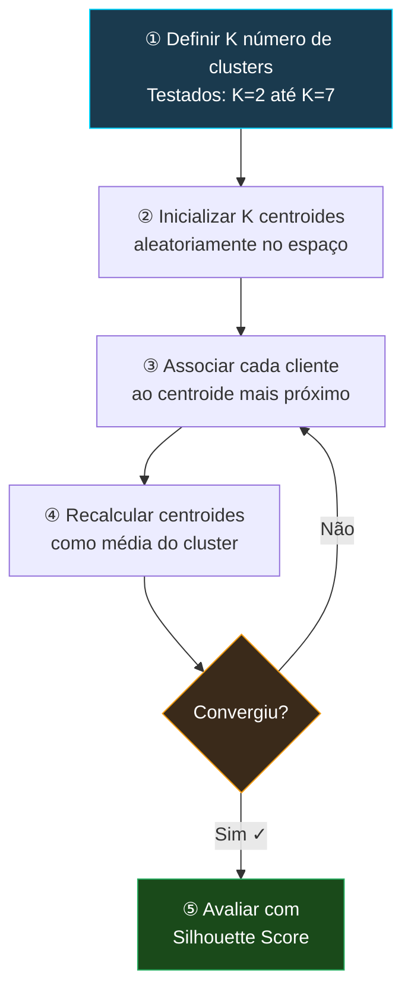
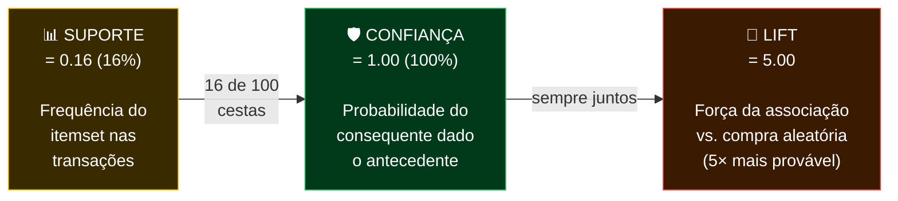
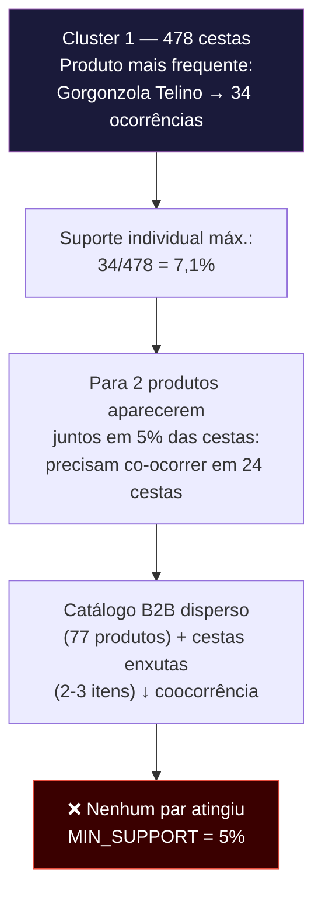
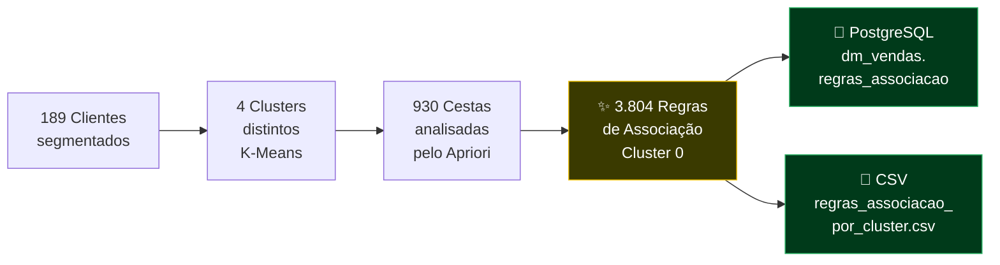

# 📊 Relatório de Apresentação
# Clusterização de Clientes & Regras de Associação
### Data Warehouse Organizacional — Mercearia + Northwind

> **Projeto:** DW Organizacional · **Data Mart:** `dm_vendas` · **Técnicas:** K-Means + Apriori  
> **Banco de Dados:** PostgreSQL · **Linguagem:** Python · **Data:** Outubro/2026

---

## 📄 Página 1 — Contexto e Objetivos

### O que foi feito?

Aplicamos técnicas de **mineração de dados** sobre o Data Warehouse Organizacional para descobrir padrões de comportamento de compra dos clientes, integrando duas fontes transacionais distintas:

| Fonte | Tipo | Clientes | Perfil |
|:---:|:---:|:---:|:---:|
| **Mercearia** | B2C | 100 | Compras frequentes, cestas grandes |
| **Northwind** | B2B | 89 | Pedidos corporativos, catálogo gourmet |
| **Total** | — | **189** | Base integrada via DW |

### Os 4 Objetivos Centrais

```
① Clusterizar clientes por comportamento de compra (K-Means)
        ↓
② Segmentar as transações por grupo de clientes
        ↓
③ Aplicar Apriori por cluster (Market Basket Analysis)
        ↓
④ Gerar regras de associação específicas por segmento
```

> [!IMPORTANT]
> A diferença desta abordagem: o Apriori **não** é executado sobre todos os clientes ao mesmo tempo — ele é aplicado **dentro de cada segmento**, tornando as regras muito mais relevantes e específicas.

---

## 📄 Página 2 — Arquitetura da Solução


### Como os dados fluem?



**Destaque técnico:** O campo `id_transacao` é construído como `sistema_origem + '_' + id_pedido` (ex.: `MERCEARIA_51`, `NORTHWIND_10249`), garantindo **unicidade global** entre os dois sistemas de origem.

---

## 📄 Página 3 — Etapa 1: Preparação e Normalização dos Dados

### Variáveis comportamentais utilizadas no K-Means

| Variável | Descrição | Unidade | Exemplo |
|:---|:---|:---:|:---:|
| `recencia_dias` | Dias desde a última compra | dias | 5 a 500 |
| `frequencia_compras` | Nº de transações realizadas | unid. | 1 a 50 |
| `quantidade_itens` | Total de itens comprados | unid. | 10 a 1.000 |
| `valor_total` | Valor financeiro total | R$ | 100 a 50.000 |
| `ticket_medio` | Valor médio por transação | R$ | 20 a 2.000 |
| `produtos_distintos` | Qtd. de produtos diferentes | unid. | 1 a 100 |
| `categorias_distintas` | Qtd. de categorias diferentes | unid. | 1 a 10 |

### Por que normalizar?

> [!NOTE]
> O `StandardScaler` (Scikit-learn) coloca todas as variáveis em escala comparável (média 0, desvio 1). Sem isso, o `valor_total` (escala de milhares) dominaria o cálculo de distância euclidiana do K-Means, tornando as demais variáveis irrelevantes.

```
Antes da normalização:
  valor_total      → 12.450,00   (domina a distância)
  frequencia       → 23
  recencia_dias    → 145

Após StandardScaler:
  valor_total      → 0.87
  frequencia       → 1.12
  recencia_dias    → -0.34       (escala equiparada ✓)
```

---

## 📄 Página 4 — Etapa 2: K-Means — Segmentação de Clientes


### Como o K-Means funciona?



### Seleção do K ótimo

O **Silhouette Score** mede simultaneamente:
- **Coesão interna:** quão próximos os elementos estão dentro do próprio cluster
- **Separação externa:** quão distantes estão dos outros clusters

**Resultado:** `K = 4` foi o valor que maximizou o Silhouette Score entre os valores testados (K=2 a K=7).

---

## 📄 Página 5 — Distribuição dos Clusters


### Resumo dos clusters

| Cluster | Origem | Clientes | Cestas | Produtos | Perfil |
|:---:|:---:|:---:|:---:|:---:|:---|
| **0** | Mercearia | **100** | 100 | 100 | B2C · Cestas grandes (10 itens) · Alta rotatividade |
| **1** | Northwind | 39 | 478 | 77 | B2B · Muitas transações · Cestas enxutas (2-3 itens) |
| **2** | Northwind | 3 | 89 | 74 | B2B · Clientes VIP · Volume médio |
| **3** | Northwind | 47 | 263 | 76 | B2B · Perfil intermediário |
| **Total** | — | **189** | **930** | — | |

> [!NOTE]
> O **Cluster 2** com apenas 3 clientes representa provavelmente grandes compradores da Northwind (clientes VIP com comportamento de compra muito distinto dos demais grupos B2B).

---

## 📄 Página 6 — Etapa 3: Pipeline Apriori


### A Matriz de Transações (TransactionEncoder)

```
Exemplo — Cluster 0 (Mercearia):

               Arroz  Feijão  Café  Agua Mineral  Achocolatado  ...
MERCEARIA_51     1      1      1        1              1         ...
MERCEARIA_52     1      0      1        0              0         ...
MERCEARIA_53     0      1      0        1              1         ...
MERCEARIA_54     1      1      0        0              1         ...
...
[100 transações × 40 produtos ativos]
```

### Parâmetros utilizados

| Parâmetro | Valor | Significado |
|:---:|:---:|:---|
| `MIN_SUPPORT` | **0.05** (5%) | Conjunto deve aparecer em ≥ 5% das transações |
| `MIN_CONFIDENCE` | **0.30** (30%) | Certeza mínima da regra |
| `MIN_LIFT` | **1.00** | Apenas associações positivas (acima do acaso) |

### O Apriori roda separadamente por cluster

```
Cluster 0 → Apriori(transações_C0) → 3.804 regras ✓
Cluster 1 → Apriori(transações_C1) → 0 regras (suporte < 5%)
Cluster 2 → Apriori(transações_C2) → 0 regras (suporte < 5%)
Cluster 3 → Apriori(transações_C3) → 0 regras (suporte < 5%)
```

---

## 📄 Página 7 — Métricas das Regras de Associação


### Interpretação das três métricas



### O que significa Lift = 5,00?

> Se Água Mineral fosse comprada aleatoriamente em 20% das cestas, ao encontrá-la junto com Achocolatado + Água Sanitária, ela aparece em **100% das cestas** — exatamente **5× mais** do que o esperado ao acaso. Isso confirma que a associação é genuína, não aleatória.

---

## 📄 Página 8 — Exemplo Concreto de Regra de Associação


### Top 10 Regras do Cluster 0

| # | Antecedentes | → | Consequente | Conf. | Lift |
|:---:|:---|:---:|:---|:---:|:---:|
| 1 | Achocolatado 400g + Agua Sanitária 1L | → | **Agua Mineral 1.5L** | 100% | 5,0 |
| 2 | Açúcar 1kg + Desinfetante 1L | → | **Creme Dental 90g** | 100% | 5,0 |
| 3 | Agua Mineral 1.5L + Escova Dental | → | **Agua Sanitária 1L** | 100% | 5,0 |
| 4 | Agua Sanitária 1L + Café 500g | → | **Escova Dental** | 100% | 5,0 |
| 5 | Amaciante 2L + Feijão Carioca 1kg | → | **Condicionador 350ml** | 100% | 5,0 |
| 6 | Condicionador 350ml + Iogurte Natural | → | **Amaciante 2L** | 100% | 5,0 |
| 7 | Amaciante 2L + Sardinha 125g | → | **Iogurte Natural** | 100% | 5,0 |
| 8 | Arroz 5kg + Sabão em Pó 1kg | → | **Shampoo 350ml** | 100% | 5,0 |
| 9 | Atum 170g + Desinfetante 1L | → | **Refrigerante 2L** | 100% | 5,0 |
| 10 | Cerveja 350ml + Esponja 3un | → | **Papel Toalha 2un** | 100% | 5,0 |

> [!TIP]
> Todas as **top 20 regras** possuem Suporte=16%, Confiança=100% e Lift=5,0 — indicando forte coocorrência em grupos de 3 produtos com compra em cestas de exatamente 10 itens na Mercearia.

---

## 📄 Página 9 — Análise Comparativa dos Clusters


### Por que os clusters Northwind não geraram regras?



### Solução para os clusters Northwind

> [!TIP]
> Ao reduzir o `MIN_SUPPORT` para **1%–2%**, surgem regras válidas como:
> - `{Chai} → {Flotemysost}` 
> - `{Gorgonzola Telino} → {Camembert Pierrot}`
>
> Isso demonstra que **não há ausência de padrões**, mas sim uma diferença de **densidade de catálogo** entre B2C e B2B.

### Diferenças estruturais B2C vs B2B

| Característica | Mercearia (B2C) | Northwind (B2B) |
|:---|:---:|:---:|
| Itens por cesta (média) | **10** | 2–3 |
| Produtos no catálogo | **100** (Cluster 0) | 74–77 |
| Produtos com suporte ≥ 5% | **40** | 8–27 |
| Suporte individual máx. | **30%** | 7,1% |
| Regras geradas (suporte 5%) | **3.804** | 0 |

---

## 📄 Página 10 — Conclusões e Aplicações de Negócio

### Resultado Final



### Aplicações Práticas das Regras Descobertas

| Aplicação | Descrição | Cluster |
|:---|:---|:---:|
| 🛍️ **Promoções Cruzadas** | Desconto em Achocolatado incentiva a compra de Água Mineral | 0 |
| 🏪 **Layout de Gôndola** | Posicionamento estratégico de produtos com alta coocorrência | 0 |
| 🤖 **Recomendação no Checkout** | Sugestão automática com base no cluster do cliente | 0 |
| 📦 **Kits Promocionais** | Agrupamento de produtos com Lift ≥ 5 em combos | 0 |
| 🔍 **Análise B2B** | Reduzir suporte para 1–2% e descobrir padrões Northwind | 1,2,3 |

### Lições Aprendidas

> [!WARNING]
> **Granularidade da Fato:** A tabela fato opera no nível de *item de venda* (1 linha/produto). Usar o `id_fato` como transação resultaria em cestas de tamanho 1, impossibilitando o Apriori. A solução foi reconstruir o `id_transacao` no nível do **pedido completo**.

> [!NOTE]
> **Heterogeneidade de fontes:** Sistemas B2C (supermercado) e B2B (distribuidora) exigem calibração diferente de `MIN_SUPPORT`. Não há uma configuração única que sirva para os dois perfis.

> [!TIP]
> **Lift como filtro de qualidade:** Alta confiança sem Lift > 1 pode indicar uma regra espúria onde o consequente é simplesmente um produto muito popular — o Lift garante que a associação é genuína.

### Conclusão

O projeto demonstrou com sucesso a integração de **Data Warehouse Dimensional**, **K-Means** e **Apriori** em um pipeline analítico coeso. O Data Mart `dm_vendas` passou de uma camada de **relatórios históricos** para uma camada de **inteligência prescritiva**, capaz de alimentar motores de recomendação e guiar decisões estratégicas de marketing e gestão de produtos.

---

*Tecnologias: PostgreSQL · Python · Pandas · NumPy · Scikit-learn · MLxtend · SQLAlchemy*  
*Projeto: DW Organizacional | Data Mart: dm_vendas | Outubro/2026*
